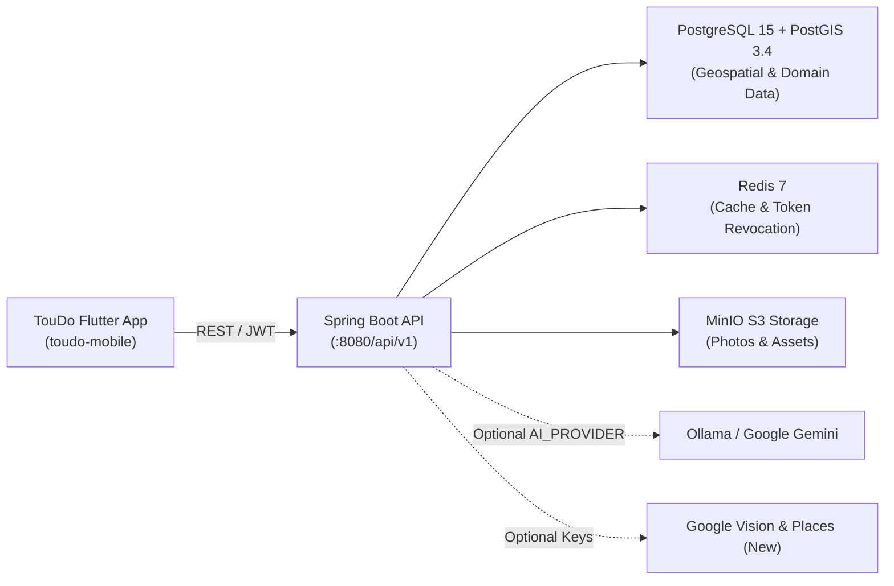

# TouDo Backend — Smart Tourism Guide API

Spring Boot REST API powering **TouDo**, an AI-assisted city guide and gamified exploration platform focused on Izmir and Ephesus, Turkey.

> Developed as a Computer Engineering Graduation Project (*Bitirme Tezi*) at **Dokuz Eylül University**.
>
> Companion mobile app: **[AkifKarakoc/toudo-mobile](https://github.com/AkifKarakoc/toudo-mobile)**

---

## Key Features

- **Geospatial Place Discovery (`PostGIS`):** Nearby POI search by radius, category, keyword, and popularity score with Redis caching and GeoHash indexing.
- **Curated Walking Routes:** Multi-stop cultural and historical routes with ordered waypoints, durations, distances, and user progress tracking.
- **Gamified Quests & Badges:** Location-aware multi-step quests (optional photo verification) and automatic XP / badge rewards.
- **AI City Guide Chat (`demo` | `ollama` | `gemini`):**
  - Runs **out of the box in `demo` mode** with a deterministic database-grounded (RAG) assistant in English and Turkish — no external LLM or API key required.
  - Supports optional **Ollama** (via LangChain4j), **Google Gemini API**, and optional **Google Places API (New)** real-time context enrichment.
- **Landmark Recognition:** Upload monument photos to identify landmarks via **Google Cloud Vision API**, with a graceful **PostGIS nearest-place fallback** when Vision is unconfigured in local development.
- **Authentication & Role-Based Security:** JWT access/refresh tokens, optional Google OAuth ID token login, and role separation (`TOURIST`, `CONTENT_EDITOR`, `MODERATOR`, `SUPER_ADMIN`).
- **Media, Reviews, Todos & Notifications:** MinIO S3-compatible object storage, star ratings and comments, personal favorites and travel todos, and in-app notification feeds.

---

## Architecture



### Package Layout

```text
src/main/java/com/tourguide/
├── admin/          # Content editor, moderator, and dashboard endpoints
├── auth/           # JWT authentication, refresh tokens, Google OAuth
├── badge/          # Achievement badges and XP progression
├── chat/           # Multi-provider AI chat (demo RAG, Ollama, Gemini) & Places enrichment
├── common/         # Security, CORS, exception handling, Liquibase & DataInitializer
├── image/          # MinIO image uploads & Google Vision / PostGIS landmark recognition
├── notification/   # User notification feeds
├── place/          # Geospatial place catalog & nearby queries
├── quest/          # Gamified multi-step quests & completion logic
├── review/         # Ratings and reviews
├── route/          # Curated walking routes & waypoints
├── todo/           # Personal travel checklists
└── user/           # User profiles, favorites, and account management
```

### Database Schema & API Collection

- **ER Diagram:** [`database schema.png`](./database%20schema.png)
- **Postman Collection:** [`TourGuide_API.postman_collection.json`](./TourGuide_API.postman_collection.json) (context path `/api/v1`)
- **Migrations:** Managed automatically on startup via Liquibase ([`db.changelog-master.xml`](./src/main/resources/db/changelog/db.changelog-master.xml))

---

## Tech Stack

| Layer | Technology |
| --- | --- |
| **Language & Framework** | Java 17+, Spring Boot 3.2.5, Spring Security |
| **Database & Geospatial** | PostgreSQL 15, PostGIS 3.4, Hibernate Spatial, Liquibase |
| **Cache** | Redis 7 |
| **Object Storage** | MinIO (`io.minio:minio`) |
| **AI & External APIs** | Built-in DB RAG (`demo`), LangChain4j + Ollama, Google Gemini, Google Vision, Google Places (New) |
| **Observability** | Spring Boot Actuator (`/api/v1/actuator/health`), Micrometer Prometheus |
| **Build & Test** | Maven, JUnit 5, Mockito |

---

## Quick Start (Local Docker Compose)

### Prerequisites

- **Docker** (with Docker Compose v2)
- **Java 17+** and **Maven 3.9+** (only needed if running outside the container)

### Option A: Infrastructure in Docker + Local Maven (Recommended for Development)

1. Copy the environment template (optional — sensible local dev defaults are already active in [`application-dev.yml`](./src/main/resources/application-dev.yml)):

   ```bash
   cp .env.example .env
   ```

2. Start **PostGIS**, **Redis**, and **MinIO**:

   ```bash
   docker compose up -d
   ```

3. Run the Spring Boot API (`dev` profile seeds demo Izmir & Ephesus data automatically):

   ```bash
   mvn spring-boot:run
   ```

4. Verify health:

   ```bash
   curl http://localhost:8080/api/v1/actuator/health
   ```

### Option B: Full Stack in Docker

Build and start infrastructure plus the backend container together using the `full` profile:

```bash
docker compose --profile full up -d --build
```

- **API Base URL:** `http://localhost:8080/api/v1`
- **MinIO Console:** `http://localhost:9001` (`minioadmin` / `minioadmin123`)

---

## Seeded Demo Data & Accounts

When `SEED_DEMO_DATA=true` (enabled by default in `dev`), Liquibase migrations and [`DataInitializer.java`](./src/main/java/com/tourguide/common/config/DataInitializer.java) idempotently populate a showcase dataset for **Izmir** (cultural landmarks/places, 3 walking routes, 5 quests, 4 badges, reviews, favorites, and todos; seeding 10 fallback highlights if the `places` table is empty).

| Role | Email | Password |
| --- | --- | --- |
| **Tourist (Demo)** | `demo@toudo.dev` | `Demo@1234` |
| **Super Admin** | `superadmin@tourguide.com` | `Admin@1234` |

---

## Optional Integrations

All third-party APIs are **optional**. Without external keys, the backend starts cleanly and uses PostgreSQL/PostGIS and the built-in `demo` AI responder. Copy [`.env.example`](./.env.example) to `.env` to enable optional providers:

| Variable | Default (`dev`) | Description |
| --- | --- | --- |
| `AI_PROVIDER` | `demo` | `demo` (built-in DB RAG), `ollama`, or `gemini` |
| `OLLAMA_BASE_URL` | `http://localhost:11434` | Local Ollama URL when `AI_PROVIDER=ollama` |
| `OLLAMA_MODEL_NAME` | `qwen3:8b` | Ollama model name |
| `GEMINI_API_KEY` | *(empty)* | Google Gemini API key when `AI_PROVIDER=gemini` |
| `GOOGLE_VISION_API_KEY` | *(empty)* | Enables landmark detection via Google Cloud Vision; falls back to PostGIS nearest place when empty |
| `GOOGLE_PLACES_API_KEY` | *(empty)* | Enables live Google Places (New) search & chat grounding |
| `GOOGLE_CLIENT_ID` | *(empty)* | Google OAuth Client ID for verifying Google Sign-In ID tokens |

---

## Running Tests

```bash
mvn clean test
```

Production container assets (`docker-compose.prod.yml`, `nginx.conf`, `deploy.sh`) are kept in the repository as deployment reference templates and require valid TLS certificates and production secrets before use.
